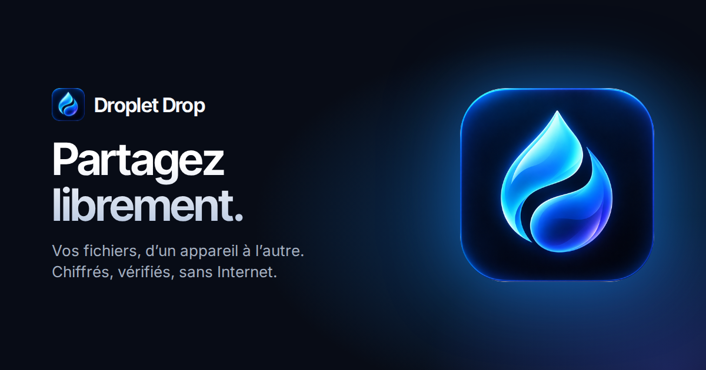

<div align="center">


# Droplet Drop — website

**Send files to the devices around you, straight over the local network.**

The official site of Droplet Drop, live at **[drop.dropletmesh.app](https://drop.dropletmesh.app)**.


[**Visit the site**](https://drop.dropletmesh.app) &nbsp;·&nbsp; [**Security**](https://drop.dropletmesh.app/security/) &nbsp;·&nbsp; [**Support**](https://drop.dropletmesh.app/support/)

<br>



</div>

<br>

## Principles

Same system, same language and same rigour as [dropletmesh.app](https://dropletmesh.app): Astro, ten languages, **no client-side dependencies, no cookies, no audience measurement**.

One rule above all: **the site never claims anything the app doesn't actually do** (checked against the `droplet` repository, `droplet-drop` branch). A platform only gets a download button once its file is published.

## Pages

| Route | Content |
|:--|:--|
| `/`, `/en/`, `/ar/`… | Home, in each of the ten languages |
| `/support/` | Help centre (10 languages) |
| `/security/` | Security (10 languages) |
| `/privacy/` | Privacy policy (French and English — legal text) |
| `/rejoindre/#…` | Group Drop invitations. One page for every language; the invitation stays after the `#` and is **never sent to the server**. |
| `/android` `/windows` `/mac` `/linux` | Short links to the files of the `drop-latest` release |

## Where to change what

| What | Where |
|:--|:--|
| Download links, publisher, contact | `src/config.ts` |
| Home page copy | `src/i18n/fr.ts` (reference), then the nine other languages — they must share exactly the same keys |
| Documents | `src/docs/fr.ts` (reference), `en.ts`, and the eight translations of Security and Support |

## Develop

```sh
npm ci
npm run dev      # http://localhost:4321
npm run build    # dist/
```

Every push to `main` is published by Vercel.

<br>

<div align="center">
<sub>
<a href="https://dropletmesh.app">Droplet</a> &nbsp;·&nbsp;
<a href="https://dropletid.dropletmesh.app">Droplet ID</a> &nbsp;·&nbsp;
<a href="https://drop.dropletmesh.app">Droplet Drop</a> &nbsp;·&nbsp;
<a href="https://web.dropletmesh.app">Droplet Web</a>
<br><br>
Designed and built in Yaoundé, Cameroon.
</sub>
</div>
